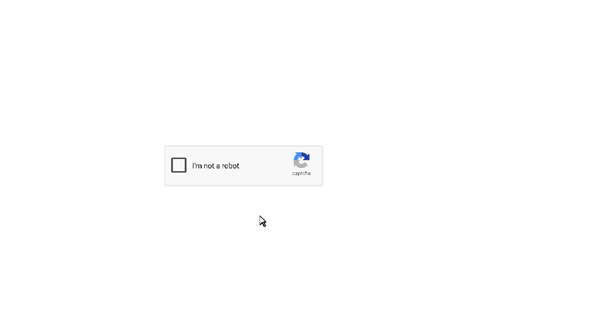
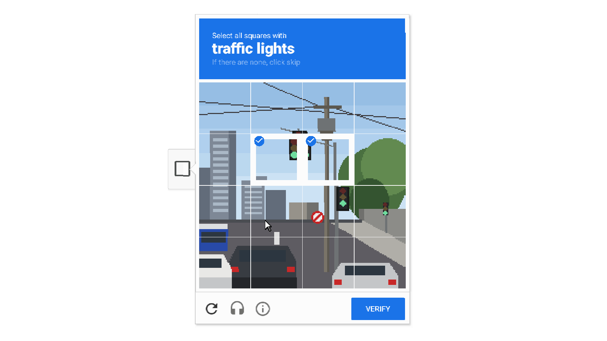

# captcha: уровень-платформер для Geometry Dash 2.2

Точная копия виджета «я не робот», собранная из объектов GD. Под логотипом написано **captcha**.
Игрок двигает курсор, наводит его на квадратик (тот плавно светлеет, как в оригинале) и кликает.
Крутится спиннер, затем открывается окно «Select all squares with **traffic lights**» с сеткой 4×4.
Нужно выбрать все клетки со светофорами и нажать VERIFY.




## Файлы

| Файл | Что это |
|---|---|
| `captcha.gmd` | уровень. Стрелки ← → двигают курсор по горизонтали, A/D — по вертикали |
| `captcha_swap.gmd` | тот же уровень с переставленными игроками: на случай, если у тебя стрелки окажутся у первого игрока |
| `preview/` | как выглядят состояния: старт, окно, выбор, ошибка, победа |
| `tools/` | всё, из чего уровень собирается (см. ниже) |
| `assets/` | снимки настоящего виджета (без фото Google) и своя сцена со светофорами |

## Как поставить

1. Поставь [Geode](https://geode-sdk.org/) для GD 2.2.
2. В Geode установи мод **GDShare**.
3. В GD открой *Create → My Levels*. GDShare добавляет там кнопку импорта: выбери `captcha.gmd`.
4. Открой уровень и жми Play.

## Управление

Уровень в двухигровом режиме: так у игры 6 кнопок вместо 3. Кнопки «вниз» в GD нет вообще.

| Действие | ПК | Телефон |
|---|---|---|
| курсор влево / вправо | ← / → (второй игрок) | стрелки на правой половине |
| курсор вниз / вверх | A / D (первый игрок) | стрелки на левой половине |
| клик | ↑, W или пробел (прыжок любого игрока) | кнопка прыжка |

Если на ПК окажется наоборот (← → двигают по вертикали), импортируй `captcha_swap.gmd`.

## Что внутри

- **Картинка.** Плашка, окно, кнопки, иконки и тексты сняты с настоящего виджета на демо-странице Google в 2x.
  Подпись reCAPTCHA перед съёмкой заменена на «captcha». Каждый пиксель стал цветным блоком (ID 211),
  одинаковые пиксели склеены в прямоугольники. Получилось около 17 600 объектов.
- **Цвета.** Рамка чекбокса `#444746`, с курсором `#B2B2B2`, переход 0,15 с.
  Спиннер `#4D90FE`, толщина 6, оборот за 2,5 с. Окно, синяя шапка `#1A73E8`, ошибки `#D93025`: всё как на снимке.
- **Фото.** Сцену со светофорами я нарисовал сам (`tools/scene.py`), Street View Google не копировал.
  Правильные клетки: 2, 3, 6, 7, 11, 12, если считать слева направо и сверху вниз с единицы.
  Главный светофор висит ровно на стыке четырёх клеток и задевает верхний ряд всего на пару пикселей.
  Второй светофор вылезает на соседнюю клетку. Знак и красные стоп-сигналы машин сбивают с толку.
- **Поведение как у оригинала.**
  - Выбранная клетка сжимается до 80%, на ней появляется синяя галочка.
  - Когда что-то выбрано, SKIP меняется на VERIFY, а подзаголовок бледнеет.
  - SKIP без выбора показывает «Please select all matching images.».
  - Неверный выбор показывает «Please try again.» и сбрасывает все клетки.
  - При ошибке футер окна съезжает вниз на строку, как в браузере.
  - Верный выбор: окно закрывается, крутится спиннер, появляется зелёная галочка, уровень пройден.

## Как устроена логика

- **Event-триггеры** ловят нажатия: Left/Right Push/Release для P1 и P2 (поле Extra ID2) и Jump Push любого игрока.
- **Движение курсора.** Нажатие запускает долгий Move курсора, отпускание гасит его Stop-триггером.
- **Края экрана.** Невидимые Collision-блоки: Collision останавливает курсор у края,
  а Instant Collision не даёт тронуться в сторону стенки.
- **Клик.** Instant Collision проверяет, какой блок под остриём курсора: чекбокс, одна из 16 клеток или кнопка.
  Пока окно закрыто, клетки и кнопка выключены Toggle-триггером.
- **Состояние клетки.** У каждой клетки два обработчика, «выбрать» и «снять»; включён всегда один.
  Счётчики Pickup: сколько выбрано и сколько ошибок. Instant Count решает, что показать.
- **Игроки.** Скрыты Options-триггером и стоят в белом загоне в кадре. Камера статична на виджете.

## Пересборка

```bash
# 1. снимки настоящего виджета (нужен Playwright с Chromium и интернет)
python3 tools/scene.py assets/scene.png assets/scene_mask.png
PW=$(npm root -g)/playwright node tools/capture.js assets/scene.png /tmp/capture
python3 tools/clean_capture.py /tmp/capture assets/capture

# 2. уровень, превью и проверка логики
python3 tools/build_level.py assets/capture assets/scene.png assets/scene_mask.png captcha.gmd preview
python3 tools/build_level.py assets/capture assets/scene.png assets/scene_mask.png captcha_swap.gmd --swap
python3 tools/simulate.py captcha.gmd
python3 tools/simulate.py captcha_swap.gmd --swap
```

`simulate.py` прогоняет весь сценарий на упрощённой модели триггеров:
- движение и упор в края;
- наведение;
- клик по чекбоксу;
- выбор и снятие клеток;
- обе ошибки;
- неверный ответ;
- победу.

## Что не проверено в самой игре

У меня не было GD под рукой. Формат взят из документации ([gddocs](https://wyliemaster.github.io/gddocs/),
[gd-info-explorer](https://flowvix.github.io/gd-info-explorer/), заголовки Geode). Логика проверена только симулятором.
Если что-то поведёт себя не так, вот где искать:

- **Старт.** Игроки появляются в загоне слева от капчи: точку задаёт Spawn Group уровня (kA36 —
  группа объекта, у которого появляется игрок). Логику запускает Spawn-триггер на x = 0,
  он левее точки появления и срабатывает сразу.
- **Игроки.** Загон — закрытая белая коробка высотой два блока: P1 стоит на полу,
  перевёрнутый P2 висит под потолком.
- **Кто из игроков на стрелках.** Если наоборот, бери `captcha_swap.gmd`.
- **Прозрачность групп.** Видимость сделана Alpha-триггерами. Я рассчитываю, что прозрачности нескольких групп одного объекта перемножаются.
